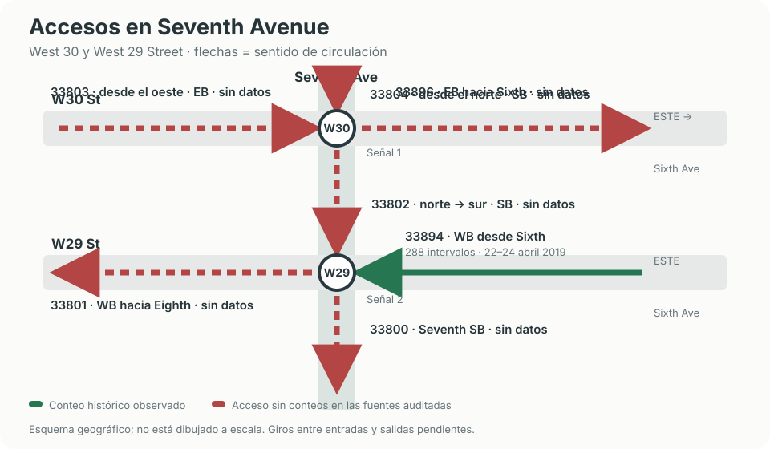

# Red y accesos del estudio

- **W30:** llegan vehículos por Seventh Avenue desde el norte, hacia el sur (33804), y por W30 desde el oeste, hacia el este (33803). El tramo hacia W29 llega desde el norte, hacia el sur (33802).
- **W29:** el conteo observado, 33894, llega **desde Sixth Avenue al este**, viajando **hacia el oeste (WB)**. Los segmentos 33801 y 33800 son salidas.
- **Cobertura:** 33894 tiene 288 conteos de 15 minutos, del 22 al 24 de abril de 2019. Los otros seis segmentos del esquema no tienen conteos en las fuentes auditadas.
- **Giros:** el esquema indica los tramos y sentidos observados. Los movimientos posibles entre una entrada y una salida se definirán como supuestos.

**Idea clave:** «desde el este» indica el lado por donde llega el vehículo; WB indica la dirección en que viaja. En este caso ambas cosas son compatibles: llega desde el este viajando hacia el oeste.
